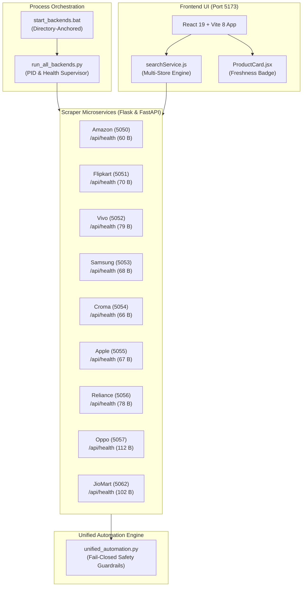

# SaleFox — Multi-Store E-Commerce Price Intelligence & Automation Engine

[](https://github.com/yashanshrastogi/SaleFox-V1.0-Fixed-all-bugs-)
[](https://github.com/yashanshrastogi/SaleFox-V1.0-Fixed-all-bugs-)
[-informational.svg)](https://github.com/yashanshrastogi/SaleFox-V1.0-Fixed-all-bugs-)

SaleFox is a distributed price intelligence, product discovery, and automated shopping bot platform designed to aggregate, compare, and monitor pricing across major consumer electronics marketplaces and direct-to-consumer brand stores in India.

---

## 1. Architecture Overview

SaleFox operates as a distributed hybrid architecture:
- **Frontend Single Page Application**: Built with React 19 and Vite 8, featuring parallel fan-out search streaming, natural language query parsing, budget filtering, data provenance freshness badges, and automated bulk ordering modals.
- **Backend Microservices**: 9 independent Python microservices (Flask and FastAPI) orchestrating real-time store scrapers, high-performance health monitors, and bot engines.
- **Process Orchestration**: A directory-anchored supervisor (`run_all_backends.py` and `start_backends.bat`) managing concurrent service lifecycles with built-in readiness validation, lightweight health polling, and clean process termination.
- **Unified Automation Engine**: A fail-closed headless browser purchasing pipeline (`src/backend/unified_automation.py`) with strict input validation, multi-tier execution modes, and order placement holds.



---

## 2. Store & Port Topology

SaleFox supports 14 store configurations. 9 stores are fully operational with dedicated backend services, and 5 stores are cleanly isolated pending future backend development:

| Service | Store | Technology | Port | Health Endpoint | Status |
|---|---|---|---:|:---:|:---:|
| **Amazon** | Amazon.in | Flask / Requests / BS4 | `5050` | `/api/health` | 🟢 Operational |
| **Flipkart** | Flipkart.com | Flask / Requests / BS4 | `5051` | `/api/health` | 🟢 Operational |
| **Vivo** | Vivo Official Store | Flask / Waitress | `5052` | `/api/health` | 🟢 Operational |
| **Samsung** | Samsung Direct | FastAPI / Uvicorn | `5053` | `/api/health` | 🟢 Operational |
| **Croma** | Croma Retail | FastAPI / Uvicorn | `5054` | `/api/health` | 🟢 Operational |
| **Apple** | Apple Store India | Flask / Requests / BS4 | `5055` | `/api/health` | 🟢 Operational |
| **Reliance** | Reliance Digital | Flask / Requests / BS4 | `5056` | `/api/health` | 🟢 Operational |
| **Oppo** | Oppo Official Store | FastAPI / Uvicorn | `5057` | `/api/health` | 🟢 Operational |
| **JioMart** | JioMart Digital | FastAPI / Uvicorn | `5062` | `/api/health` | 🟢 Operational |
| **Vijay Sales** | Vijay Sales | *Pending Integration* | `5063` | *N/A* | ⏳ Coming Soon |
| **Poorvika** | Poorvika Mobiles | *Pending Integration* | `5058` | *N/A* | ⏳ Coming Soon |
| **Sangeetha** | Sangeetha Gadgets | *Pending Integration* | `5059` | *N/A* | ⏳ Coming Soon |
| **OnePlus** | OnePlus India | *Pending Integration* | `5060` | *N/A* | ⏳ Coming Soon |
| **Xiaomi** | Mi Store India | *Pending Integration* | `5061` | *N/A* | ⏳ Coming Soon |

---

## 3. Data Provenance & Freshness Indicators

To maintain honesty when third-party retail platforms block live headless requests, SaleFox distinguishes between real-time scraped pricing and baseline cached data:
- **`● Live Store API` / `● Live Stock Checked`** (Green pulsing indicator): Data scraped in real-time from active store microservices.
- **`○ Store Catalog`** (Muted gray ring): Baseline pre-indexed product catalog loaded from bundled disk storage.
- **`○ Catalog Fallback`** (Amber ring): Static fallback data returned when a live retailer scraper was throttled or timed out.

---

## 4. System Requirements

- **Operating System**: Windows 10 or 11 (64-bit)
- **Node.js**: v18.0.0 or higher (v20+ LTS recommended)
- **Python**: 3.10 or 3.11 (64-bit) with `pip`
- **Google Chrome**: (Optional) required only if running live automated checkout bots

---

## 5. One-Time Setup Instructions

### 1. Clone the Repository
```powershell
git clone https://github.com/yashanshrastogi/SaleFox-V1.0-Fixed-all-bugs-.git
cd SaleFox-V1.0-Fixed-all-bugs-
```

### 2. Configure Python Virtual Environment
Initialize a local `.venv` environment and install all unified backend dependencies:
```powershell
# Create virtual environment
python -m venv .venv

# Install verified dependencies
.\.venv\Scripts\pip install -r requirements.txt
```

### 3. Install Frontend Dependencies
```powershell
npm ci
```

### 4. (Optional) Configure Environment Variables
Copy `.env.example` to `.env` to configure custom pincodes or regional settings:
```powershell
Copy-Item .env.example .env
```

---

## 6. Daily Startup Instructions

### Method A — Windows Batch Scripts (Recommended)

1. Double-click **`start_backends.bat`**
   - Automatically anchors execution to the project directory.
   - Detects the project-local `.venv\Scripts\python.exe`.
   - Concurrently initializes all 9 microservices.
   - Verifies readiness via lightweight `/api/health` polling.
   - Confirms when all services are healthy and listening.

2. Double-click **`start_frontend.bat`**
   - Launches the Vite React development server on port 5173.

3. Open **`http://localhost:5173`** in your browser.

---

### Method B — PowerShell Terminal

#### Terminal 1 — Backend Microservices
```powershell
.\.venv\Scripts\python.exe run_all_backends.py
```

#### Terminal 2 — Frontend User Interface
```powershell
npm run dev
```

---

## 7. Verification & Automated Testing Suite

SaleFox includes a structured test suite in `tests/`:

```powershell
# 1. Frontend Linter (105 active rules)
npm run lint

# 2. Frontend Production Build
npm run build

# 3. Fail-Closed Checkout Safety Unit Tests (12/12 test vectors)
.\.venv\Scripts\python.exe tests\security\test_checkout_safety.py

# 4. Catalog Reconciliation & Count Verification
.\.venv\Scripts\python.exe tests\integration\reconcile_catalogs.py

# 5. Frontend Batch Portability Tests (4 distinct directories)
.\.venv\Scripts\python.exe tests\integration\test_batch_portability.py

# 6. Full End-to-End System Regression (Startup, Health, Search, Port Release)
.\.venv\Scripts\python.exe tests\integration\full_system_regression.py
```

---

## 8. Security & Checkout Safety Guardrails

- **Fail-Closed Customer Profile Validation**: Missing or invalid customer profiles are strictly rejected before browser automation spawns.
- **Anti-Fraud & Dummy Data Filtering**: The engine rejects dummy phone numbers (`9876543210`), dummy names (`SaleFox Customer`), and placeholder email domains (`@example.com`).
- **Default Dry-Run Mode**: Automation defaults to `dry_run` mode (which inspects product pricing and fills forms for verification but halts before purchase).
- **Payment Safeguard**: An explicit safety hold is enforced in `click_place_order()` to prevent automated financial charges.
- **Git Shield**: `.gitignore` strictly blocks all `.env*` files, browser session profiles (`amazon_profiles/`, `reliance_profiles/`, `user-data/`), and Python virtual environments from entering version control.

---

## 9. Known Limitations & Production Prerequisites

Before deploying SaleFox to an external, public-facing cloud production environment:
1. **Residential Proxy Rotation**: Retailers (particularly Amazon and Flipkart) aggressively throttle datacenter IP addresses. A residential proxy provider should be configured in `HEADLESS_SCRAPER_PROXY`.
2. **Multi-Tenant User Sessions**: Customer delivery profiles must be securely stored in an authenticated database rather than client-submitted payloads.
3. **Containerization**: Deploying microservices as isolated Docker containers on Kubernetes or Cloud Run is recommended for high-availability scaling.

---

## 10. License

The license for this repository is currently not specified. All rights are reserved by the original authors.
